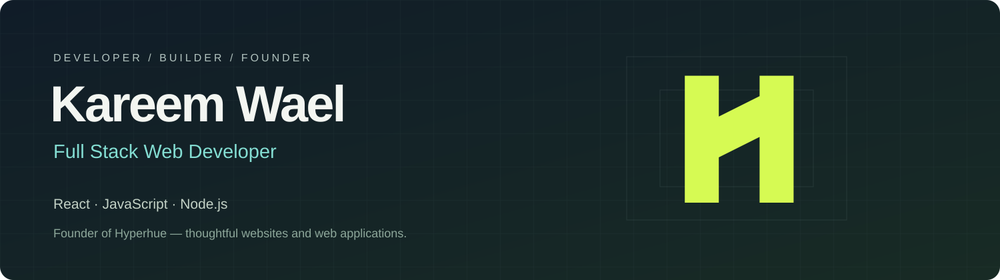

# Hi, I’m Kareem Wael

**Full Stack Web Developer · Founder of Hyperhue**

I build responsive interfaces and the backend services behind them with **React, JavaScript, and Node.js**. I care about clear user flows, maintainable code, and useful finished products.

[**Visit my personal portfolio →**](https://kareem-wael-personal-portfolio.kareemw527.chatgpt.site/)

My personal website has its own address and contains my work, skills, contact details, and interactive character. Its source code is private and separate from the Hyperhue agency project.

 

## Featured project — EverSmile

A full stack dental clinic project I built with a responsive services website, appointment booking, doctor and assistant dashboards, and a Node.js REST API.

[**View website →**](https://kareemw527-svg.github.io/EverSmile/) · [**Explore source →**](https://github.com/kareemw527-svg/EverSmile)

The online version is a portfolio demo with fictional sample data, not a live clinic service.

## What I’m building

**Hyperhue** — a digital studio creating professional websites and web applications for service businesses and startups.

The separate private Hyperhue repository contains the agency website and team workspace. My personal portfolio has its own website, without the company pages or employee dashboard.

## Technologies I use

React · JavaScript · Node.js · HTML · CSS · Bootstrap · Vite · Git

## How I approach the work

- Understand the problem before defining the features.
- Connect interface decisions with API and data behavior.
- Check the details: responsive layouts, accessibility, and meaningful tests.
- Make the handover clear enough for the next person to use.

## Get in touch

For website projects, collaboration, or development opportunities:  
[kareemw527@gmail.com](mailto:kareemw527@gmail.com)
